# Guía del panel

Para ver un recorrido rápido por la pantalla, tocá **Cómo usar** arriba de
**Conversaciones**. Se abre una conversación de ejemplo: lo que toques ahí no se manda a nadie.

Esta guía tiene dos partes: **Todos los días**, con las tareas de siempre, y **Si pasa algo
raro**, para cuando algo no sale como esperabas. Las capturas usan nombres y números inventados.

Si en algún momento no sabés qué hacer en una pantalla, leé la línea gris que está debajo del
título: dice para qué sirve, y **Ver en la guía** te trae a la parte que corresponde.

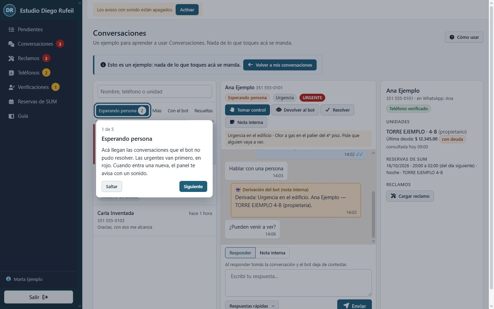

# Todos los días

## Empezá el día en Pendientes

Al entrar al panel se abre **Pendientes**: una tarjeta por cada cosa que espera a alguien del
estudio, con cuántas son. Tocá el botón de la tarjeta y vas directo a esa lista.

- **Esperando persona**: conversaciones que el bot no pudo resolver. Dice cuántas son urgentes y
  hace cuánto espera la más vieja.
- **Mías sin responder**: conversaciones que tomaste vos, donde te escribieron y todavía no
  contestaste.
- **Reclamos que necesitan atención**: los urgentes y los que tienen un problema con el
  proveedor o la demora.
- **Teléfonos a revisar** y **Verificaciones pendientes**.
- **Reservas del SUM** de hoy y de mañana, para saber qué turnos hay.

Una tarjeta gris que dice **Al día** no tiene nada pendiente. Si todas están así, arriba dice
**Todo al día**. Los números se actualizan solos, y también se ven en el menú, al lado de
Conversaciones, Reclamos, Teléfonos y Verificaciones (en rojo si hay algo urgente).

**Avisos con sonido:** arriba de todas las pantallas está el botón **🔔 Activar avisos**. Tocalo
una vez y aceptá cuando el navegador pregunte. Desde ahí, en cualquier pantalla del panel suena
y aparece un aviso cuando entra una conversación a «Esperando persona», un reclamo urgente o un
reclamo que necesita atención. Si los avisos están apagados, una franja arriba te lo recuerda.
El navegador solo deja sonar después de que tocaste algo en la página: al cambiar de pantalla,
con el primer clic ya queda listo. El número entre paréntesis en la pestaña del navegador
(«(3) Pendientes · Panel…») te dice cuántas cosas esperan aunque estés en otra pestaña.

**En el celular:** abajo hay una barra con **Pendientes**, **Conversaciones**, **Reclamos** y
**Más** (Teléfonos, Verificaciones, Reservas de SUM, Guía y Salir), con los mismos números. Los
avisos son la campana de arriba: si está tachada, tocala para activarlos.

**Como una app en el celular:** en el navegador del celular, elegí **Agregar a inicio** (en el
iPhone, desde el botón de compartir de Safari). Queda un ícono «DR» que abre el panel a
pantalla completa; para volver, usá **← Volver** en cada ficha o la barra de abajo. Si lo
agregaste al inicio del iPhone, la primera vez ingresá de nuevo con tu usuario.

**Al aprobar, rechazar o cerrar algo**, la página no se recarga: la fila se va o el bloque se
actualiza, y abajo aparece un aviso chico que se va solo. Si algo sale mal, el aviso queda
hasta que lo cerrás y dice qué pasó. Si dice «No se pudo confirmar si se guardó», tocá
**Recargar** para ver cómo quedó antes de volver a intentarlo.

## Cómo es un día

**Al llegar:** abrí el panel y dejalo abierto en una pestaña todo el día. Si dice que los avisos
están apagados, tocá **Activar**. Mirá **Pendientes**: primero lo urgente (en rojo), después lo
que quedó esperando desde la noche, los reclamos que necesitan atención, las verificaciones y los
teléfonos.

**Durante el día:** cuando suena, abrí la conversación, tomala y respondé. Cuando termines,
resolvela o devolvésela al bot. Lo que llega por teléfono o en persona (un reclamo, una reserva)
cargalo en el panel, así queda todo junto. Para pasarle algo a tu compañera, dejá una nota
interna.

**Antes de irte:** que no te queden conversaciones en **Mías**: resolvelas, devolvéselas al bot
o dejá una nota con lo que falta. Mirá **Pendientes** una última vez.

**Reglas:**

- Si la tomaste, la terminás: mientras la tengas, el bot no le contesta.
- Lo que entra por teléfono va al panel.
- No prometas plazos que no dependen del estudio.
- Los montos de deuda salen de la ficha de la persona.
- Si dudás antes de **Desvincular** o **Rechazar**, dejá una nota y consultá.

## Conversaciones

El bot contesta solo la mayoría de los mensajes. Cuando no puede (la persona pide hablar con
alguien, hay un reclamo o una urgencia), la conversación pasa a **Esperando persona** y el panel
te avisa con un sonido.

1. Entrá a **Conversaciones**. La pestaña **Esperando persona** muestra cuántas hay. Las
   urgentes están primero, marcadas en rojo.
2. Tocá la conversación para abrirla. Arriba vas a ver por qué la mandó el bot y un resumen.
   A la derecha están los datos de la persona: sus unidades, su última deuda y sus reservas.
3. Tocá **Tomar control**. Desde ese momento el bot no le contesta más y la conversación
   queda en **Mías**.
4. Escribí tu respuesta y tocá **Enviar**. Si querés, usá **Respuestas rápidas** para pegar un
   texto guardado.
5. Cuando terminaste, elegí una de dos:
   - **Resolver**: la conversación pasa a **Resueltas**. Si la persona vuelve a escribir, la
     atiende el bot.
   - **Devolver al bot**: si el bot puede seguir solo (por ejemplo, para darle la deuda o el
     código de pago).

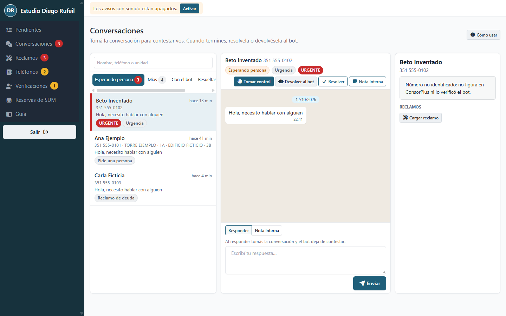

Para dejar algo anotado que la persona no ve, usá **Nota interna**. Las notas quedan en
amarillo en la conversación y las ven todas las del estudio.

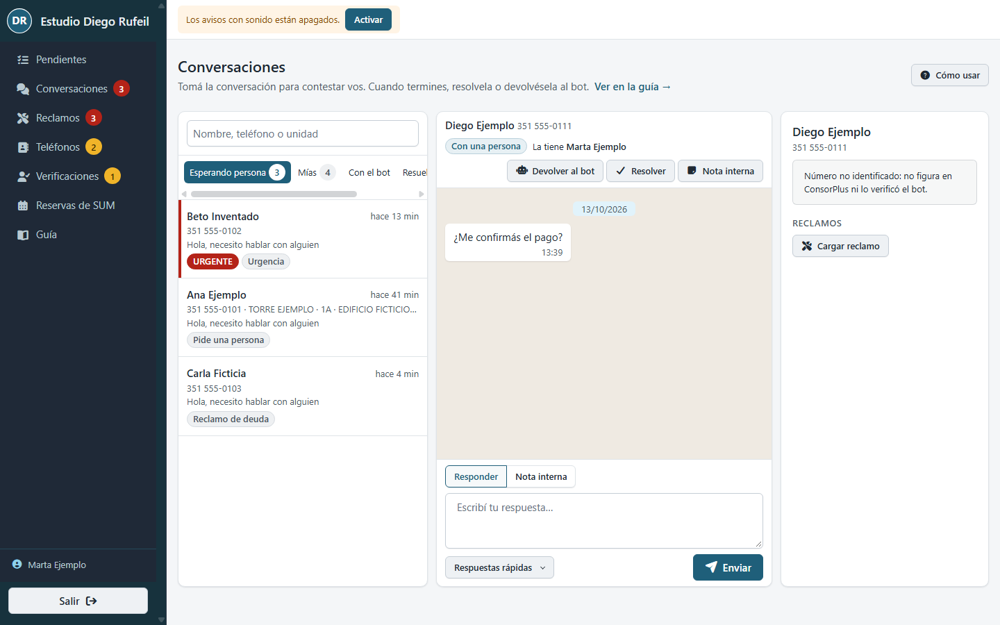

## Responder cuando pasó más de un día

WhatsApp no deja escribirle libremente a alguien cuyo último mensaje fue hace más de un día
(24 horas). En ese caso, en lugar de la caja para escribir vas a ver un aviso y una lista de
mensajes ya preparados.

1. Abrí la conversación.
2. Elegí el mensaje preparado que corresponda (por ejemplo, «Retomar la charla»).
3. Tocá **Enviar mensaje preparado**.
4. Cuando la persona conteste, vas a poder escribirle normalmente.

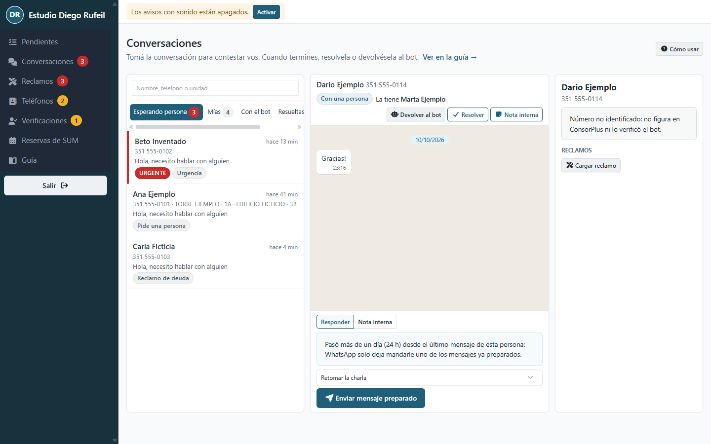

## Reclamos

Los problemas que reportan los vecinos (el ascensor, el agua, una filtración…) están en
**Reclamos**. Algunos los registra el vecino por WhatsApp; otros los cargás vos.

**Qué ves**

- En **Abiertos** están los que hay que resolver; los urgentes van primero, con una raya roja.
  La lista se actualiza sola (no mientras escribís en el buscador o tenés los filtros
  abiertos).
- Cada renglón dice el edificio y la unidad, el problema, quién reclamó, quién lo atiende y el
  estado en pocas palabras: **Falta avisar**, **Avisado**, **Confirmado**, **Lo tiene el
  estudio**, **Solucionado** o **Cancelado**. Debajo, hace cuánto está así y, si hace falta, por
  qué hay que mirarlo.
- Tocá el número (por ejemplo **#1003**) para ver todo: qué pasa, quién reclamó, los vecinos que
  se sumaron, quién lo atiende y la historia.
- Para buscar uno, escribí el número, la unidad, el nombre o parte del teléfono.

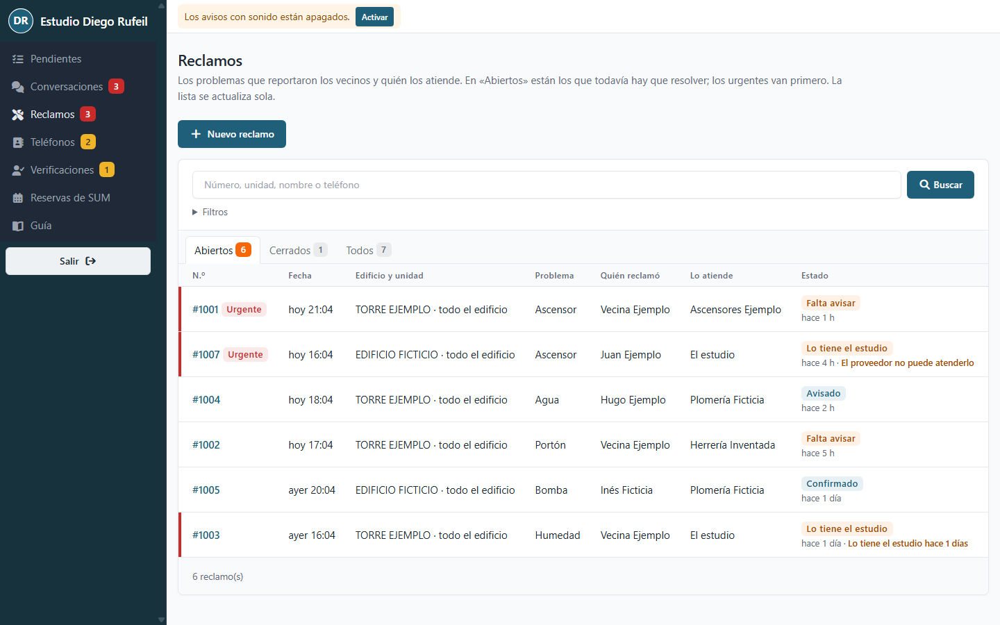

**El botón principal**

En la ficha, **Qué hacer** muestra un botón azul con lo que toca según el estado, y lo demás en
**Otras acciones**:

- **Falta avisar:** **Reenviar al proveedor**. Si el proveedor no tiene WhatsApp: **Marcar como
  avisado**, después de llamarlo.
- **Avisado:** no hay botón azul: falta que el proveedor confirme.
- **Confirmado:** **Cerrar como solucionado**, cuando el problema está resuelto.
- **Lo tiene el estudio:** si el proveedor dijo que no puede, **Elegir proveedor**. Si ese
  problema lo resuelve el estudio, **Cerrar como solucionado**.

Antes de hacer algo, el panel te dice qué va a pasar y a quién se le avisa, y ahí mismo te pide
lo que haga falta: el motivo para cerrar o cancelar (es obligatorio), o el proveedor.

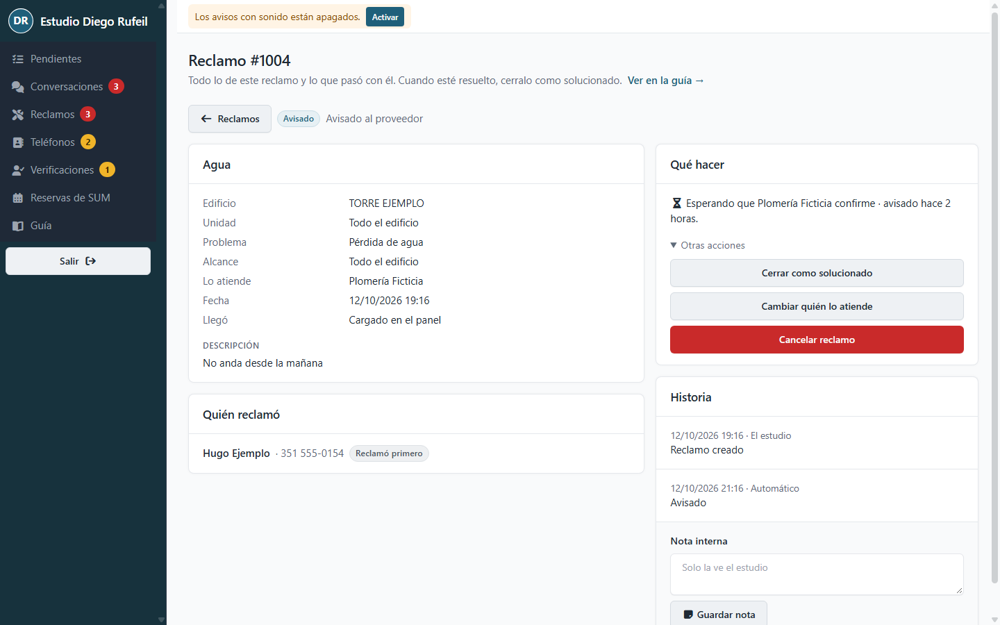

**Cargar uno que llegó por teléfono o en persona**

1. En **Reclamos**, tocá **Nuevo reclamo**.
2. En **¿Quién reclama?**, escribí el nombre, la unidad (por ejemplo 02-B) o el teléfono, y
   tocá a la persona. El edificio y la unidad quedan elegidos.
3. Si no está en el padrón, tocá **No está en el padrón**: elegí el edificio y escribí su
   nombre y su teléfono.
4. Elegí el problema y contá qué pasa.
5. Tocá **Cargar reclamo**. Si ya había un reclamo abierto del mismo problema en el edificio,
   no se carga otro: la persona se suma a ese y el panel te lo abre.

**Desde una conversación:** en la ficha del contacto (en el celular, en **Ficha del
contacto**), tocá **Cargar reclamo**. La persona ya viene elegida (si tiene varias unidades,
elegís cuál) o, si el número no es de nadie, el teléfono ya viene cargado. El reclamo queda
unido a la conversación y en ella aparece la nota «Se cargó el reclamo #N», con el link.

Al vecino no le llega nada cuando lo cargás. Después le llega un aviso cuando el proveedor
confirma y cuando se cierra como solucionado.

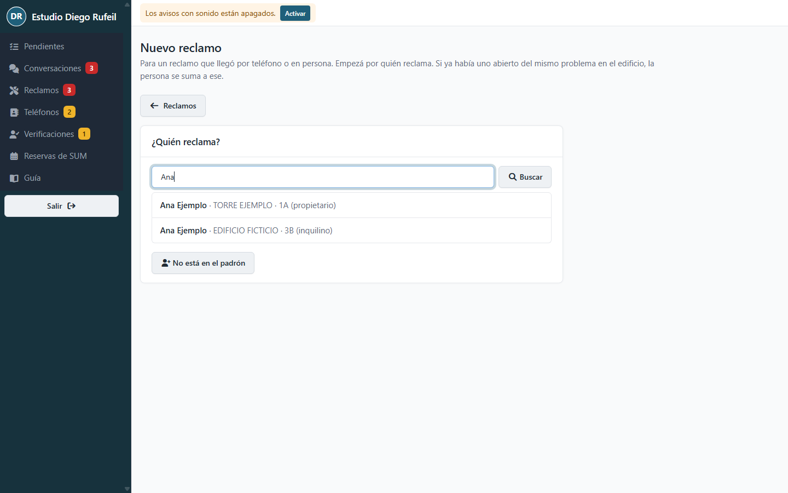

**Cerrarlo o cancelarlo**

- **Cerrar como solucionado:** contá qué se hizo. A quien reclamó y a los vecinos que se
  sumaron les llega por WhatsApp que está solucionado.
- **Cancelar reclamo** (en **Otras acciones**): contá por qué (por ejemplo, estaba repetido).
  Al vecino no le llega nada: si querés que sepa, escribile desde **Conversaciones**.
- Un reclamo cerrado no se vuelve a abrir. Si el problema vuelve, cargá uno nuevo: el panel lo
  une con el anterior.
- Con **Nota interna** dejás algo anotado que solo ve el estudio.

Si el proveedor no contesta, dice que no puede o es de noche, mirá
[Reclamos: el proveedor y los avisos](#reclamos-el-proveedor-y-los-avisos).

## Cargar el teléfono de un vecino

Cuando alguien te pasa su número (por teléfono, en la oficina o por WhatsApp), cargalo vos y el
bot lo reconoce desde el mensaje siguiente.

**Desde Vecinos:**

1. Entrá a **Vecinos**, elegí el edificio y buscá la unidad.
2. Tocá **Agregar persona** debajo de la unidad. Escribí el nombre y apellido: si ya está en el
   padrón, el panel te pregunta «¿Es la misma persona…?». Si es, tocá **Sí, es la misma
   persona** para no repetirla.
3. Elegí el rol: **Propietario/a**, **Inquilino/a** o **Familiar u otro**. Solo el propietario
   puede consultar la deuda por WhatsApp; los demás pueden hacer reclamos, reservar el SUM y
   preguntar por el edificio.
4. Escribí el teléfono con la característica (por ejemplo 351). Al salir del campo, el panel te
   muestra cómo lo va a guardar.
5. Tocá **Agregar** y confirmá.

**Desde una conversación:** si quien escribe no está en el padrón, en su ficha (a la derecha)
tocá **Agregar a Vecinos**. El teléfono ya va a estar puesto: elegí el edificio, la unidad y
seguí igual que arriba. Si ya está, el botón dice **Ver en Vecinos**.

Si ese número tenía una verificación pendiente, al cargarlo queda aprobada sola y deja de
aparecer en Pendientes.

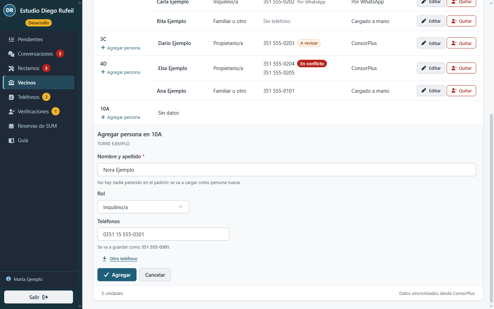

## Teléfonos

Algunos números vienen de ConsorPlus incompletos y el sistema tuvo que adivinar una parte. Hasta
que alguien los confirme, el bot no los usa.

1. Entrá a **Teléfonos**. Se abre en **A revisar** si hay alguno.
2. Fijate que el número y la persona coincidan con lo que sabés (por ejemplo, con la ficha de
   ConsorPlus).
3. Si está bien, tocá **Aprobar**. Si hay varios correctos, marcalos y tocá **Aprobar
   seleccionados**.
4. Si el número no es de esa persona, tocá **Desvincular**. El panel te va a pedir que lo
   confirmes y te explica qué pasa.

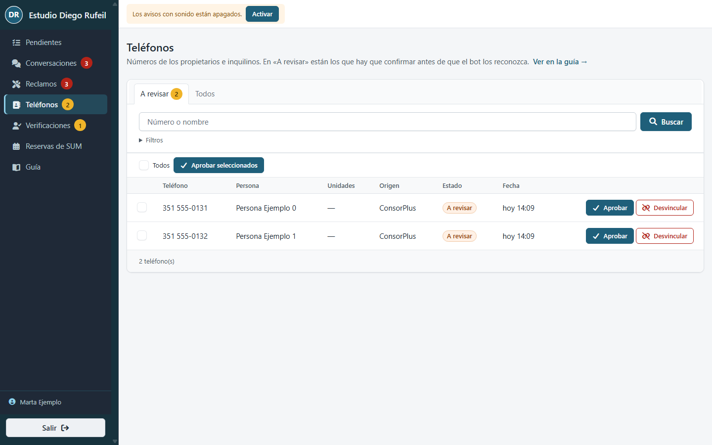

## Verificaciones

Cuando alguien se registra por WhatsApp y el bot no puede confirmarlo solo, te lo deja en
**Verificaciones**: un inquilino o un familiar (siempre), o un propietario de una unidad que no
tiene email cargado.

1. Entrá a **Verificaciones**. Cada renglón dice el edificio, la unidad, el nombre y el rol que
   dio la persona, y su teléfono.
2. Si tenés dudas, tocá **Ver conversación** para leer lo que escribió.
3. Si corresponde, tocá **Aprobar** y elegí cómo queda:
   - **Es un propietario que ya está cargado**: elegí su nombre de la lista.
   - **Cargarlo como persona nueva**: revisá el nombre y elegí el rol (Propietario/a,
     Inquilino/a o Familiar u otro). Queda también en **Vecinos**.
4. Al confirmar, el panel avisa si se le pudo mandar el aviso por WhatsApp. Si escribió hace
   más de un día y el aviso no salió, avisale vos (por ejemplo, por teléfono).
5. Si no corresponde, tocá **Rechazar**. Si escribió en las últimas 24 horas le llega un
   mensaje amable que le ofrece hablar con el estudio; si no, no le llega nada.

Mientras su registro está pendiente, el bot le contesta sobre el edificio y atiende urgencias,
pero no le da la deuda, no le reserva el SUM ni le toma reclamos: le dice que espera la
aprobación del estudio.

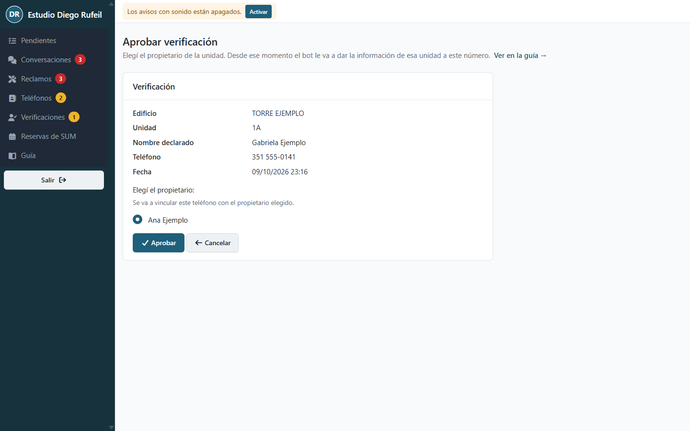

## Reservas del SUM

1. Entrá a **Reservas de SUM** y tocá **Planilla** en el edificio.
2. Los turnos verdes están libres; los azules, reservados; los grises no se pueden reservar en
   este momento (tocalos para ver por qué). Con las flechas cambiás de semana (en el celular,
   de día).
3. Para reservar, tocá un turno verde, elegí la unidad, agregá una nota si hace falta y tocá
   **Reservar**.
4. Si la unidad no cumple una regla (por ejemplo, ya reservó dos veces este mes), el panel te
   lo dice. Podés marcar **Reservar igual** si corresponde: queda registrado.
5. Para cancelar, tocá el turno azul y después **Cancelar reserva**. El turno queda libre. A la
   unidad no le llega ningún aviso: avisale vos.

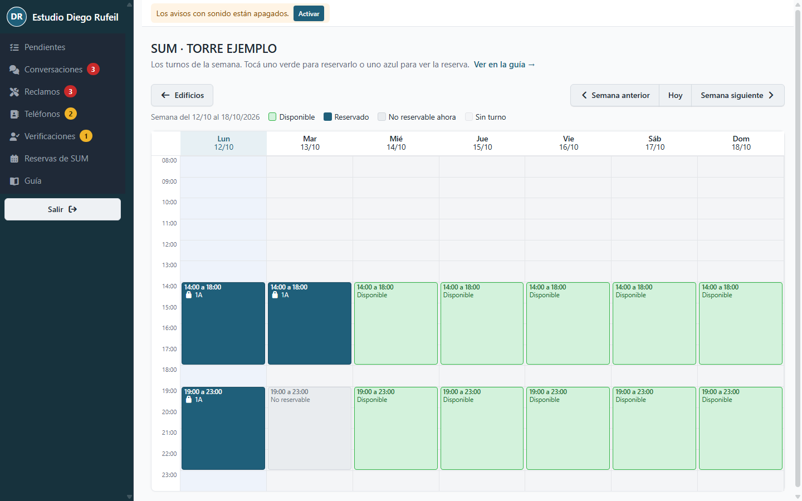

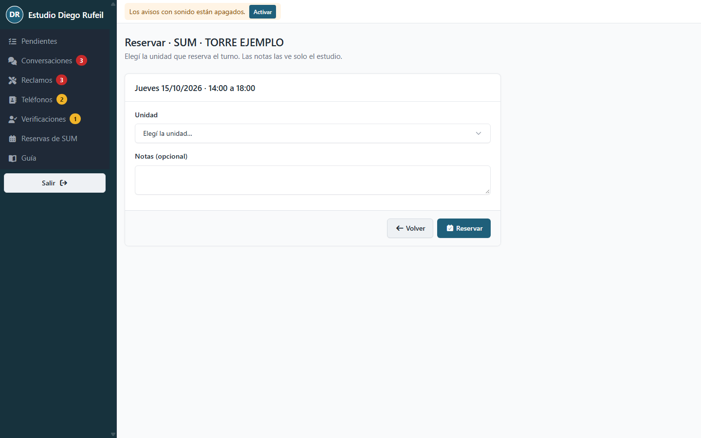

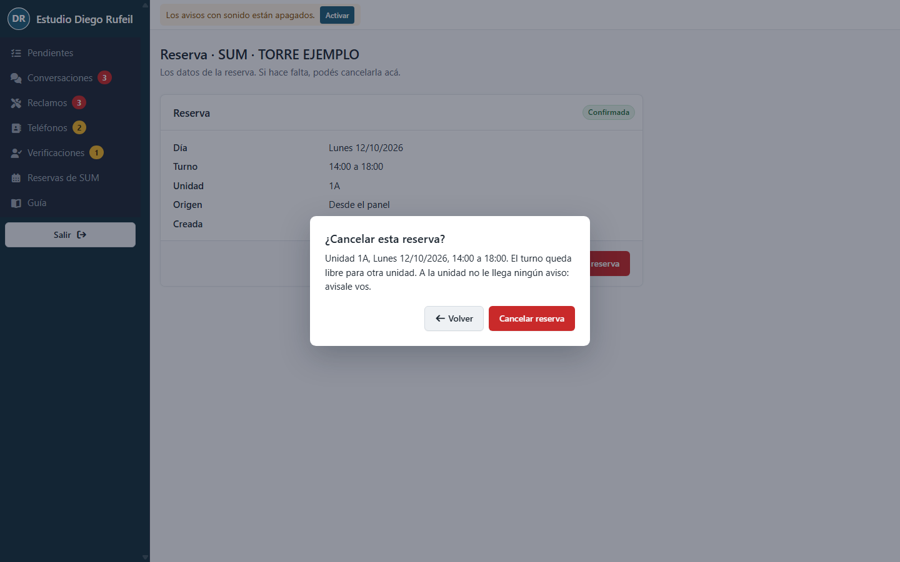

# Si pasa algo raro

## Cuando algo no anda

- **Un mensaje dice «No se entregó».** WhatsApp no lo pudo mandar (por ejemplo, el número ya
  no existe). Probá de nuevo más tarde o comunicate por otro medio.
- **No encuentro un teléfono.** Buscalo por una parte del nombre o por los últimos números, sin
  espacios. Fijate que no haya filtros aplicados.
- **Aparece «Esta sección es solo para administradores».** Esa pantalla no es para tu usuario.
  Si necesitás algo de ahí, pedíselo a un admin.
- **El bot le dio un dato mal a alguien.** Tomá la conversación, corregilo vos y dejá una nota
  interna contando qué pasó para que un admin lo revise.
- **No me deja reservar.** Leé el aviso: dice qué regla no se cumple. Si corresponde igual,
  marcá **Reservar igual**.
- **El panel no se actualiza o se ve raro.** Recargá la página. Si sigue igual, cerrá sesión
  con **Salir** y volvé a entrar.

## El número ya es de otra persona

Al cargar un teléfono, el panel te avisa «Este número es de…» con el nombre y la unidad de
quien lo tiene.

- Si el número cambió de dueño (por ejemplo, el inquilino se mudó y ahora lo usa el nuevo),
  tocá **Pasarlo a esta persona** y confirmá. La otra persona deja de tenerlo.
- Si no estás segura, tocá **Cancelar** y preguntá antes. Nada se guarda hasta que confirmes.

## Quité a alguien por error

Lo que quitás en Vecinos no vuelve solo con los datos de la noche. Para traerlo de nuevo hace
falta **Restaurar**, que es del admin: avisale qué persona y de qué unidad era. Si lo cargaste
vos a mano (no venía de ConsorPlus), también podés volver a agregarlo con **Agregar persona**.

## Reclamos: el proveedor y los avisos

**El proveedor:** si el problema tiene una empresa asignada con WhatsApp, el sistema le manda
el reclamo en el momento, con dos botones: «Recibido» y «No puedo atenderlo». Cuando confirma,
al vecino le llega un aviso; cuando toca «Ya está solucionado», el reclamo se cierra y se les
avisa a todos los vecinos que reclamaron. En la historia del reclamo ves cada aviso y si llegó
(enviado, entregado, leído).

- **No le llegó (o no tiene WhatsApp):** el reclamo queda en «Falta avisar». Tocá **Reenviar al
  proveedor** o, si le avisaste por teléfono, **Marcar como avisado** (en **Otras acciones**).
- **Dijo que no puede:** el reclamo pasa a «Lo tiene el estudio» y el panel avisa. Tocá **Elegir
  proveedor**: si tiene WhatsApp, se le manda en el momento.
- **Lo solucionaron y el proveedor no avisó:** **Cerrar como solucionado** también les avisa a
  los vecinos. **Cancelar reclamo**, en cambio, no le avisa a nadie.
- Los proveedores aparecen en **Conversaciones**, pestaña **Proveedores**. El bot no les
  contesta: si escriben algo, lo ven ustedes y pueden responderles.

**El horario de los proveedores:** a las empresas se les escribe en su horario (de lunes a
sábado de 8 a 20, salvo feriados; se cambia en **Configuración de reclamos**). Un reclamo que
llega de noche queda programado y sale solo cuando empieza el horario: en la ficha dice «Se le
manda a … mañana a las 8:00», con un botón **Mandar ahora** por si no puede esperar. Los
urgentes salen siempre en el momento. Si reenviás o cambiás el proveedor fuera de horario, el
panel te pregunta si mandarlo ahora o en el próximo horario.

**Si el proveedor no contesta:** si no toca «Recibido», el sistema le manda un recordatorio una
sola vez (a las 4 horas de su horario; a los 30 minutos si es urgente). Si sigue sin confirmar,
el panel avisa con sonido: «El proveedor no confirmó». También avisa cuando un reclamo confirmado
sigue sin solucionar a los 3 días, cuando lo tiene el estudio hace 3 días, o cuando todavía no se
le avisó al proveedor. El aviso se va solo cuando alguien hace algo (confirma, se cambia el
proveedor, se cierra). En la lista, el filtro **Atención → Necesitan atención** muestra esos y
los urgentes abiertos.

**Reclamos urgentes:** cuando entra uno (por ejemplo, olor a gas), el panel suena y muestra un
aviso, igual que «Esperando persona», y al lado de **Reclamos** en el menú aparece un número
rojo. Para que suene, activá los avisos con **🔔 Activar avisos**, arriba de cualquier pantalla.
La conversación sigue con el bot: si hace falta, tomala vos.
